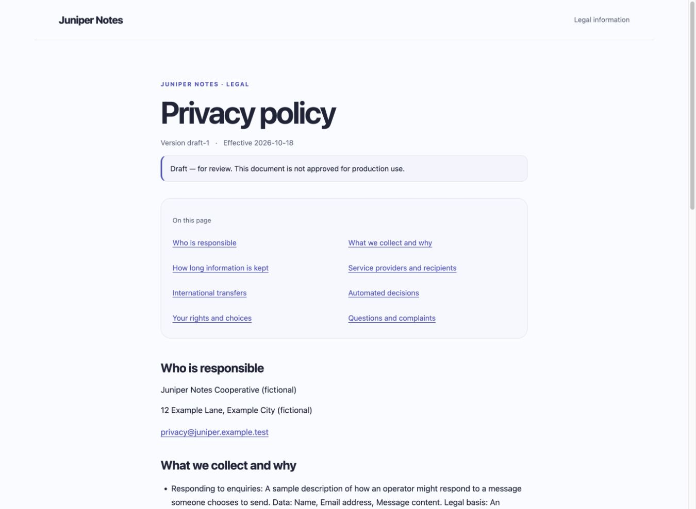
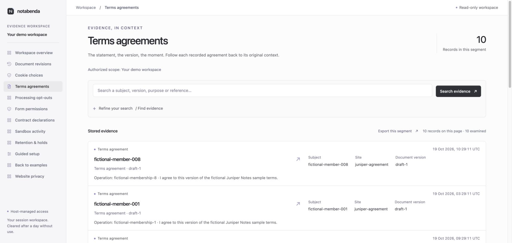
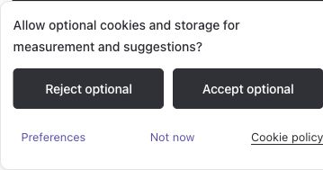
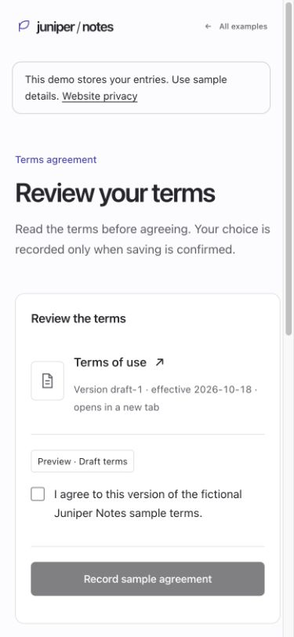

<p align="center">
  
</p>

<p align="center">Legal pages that feel like part of your site.</p>

Notabenda gives you reusable site configuration and privacy, cookie, and terms pages you can host yourself. Your facts and content stay yours. The pages use your design, work without JavaScript, and don't depend on a remote policy service.

**Developer preview.** The packages have not been published to npm yet. Document rendering, build tooling, local consent state, vanilla cookie controls, and version-bound terms agreement work. Broader regional features remain in development. See the [current scope](docs/SCOPE.md) and [feature status](docs/FEATURES.md).

Explore the [website and documentation](https://notabenda.org) or try the [examples and your own temporary demo workspace](https://notabenda.org/examples/).

## Try it

Repository tooling requires Node.js 22.22+ (including the Astro example) and Python 3.9+ for catalog checks. The core package itself supports Node.js 22+.

```sh
npm install
npm run dev
```

Open [the local example](http://127.0.0.1:4178). It includes privacy, cookie, and supplied terms pages in two themes, using a fictional operator and draft content.

Try [live cookie choices](http://127.0.0.1:4178/choices): a small permission notice, a user-opened preferences drawer, and synthetic optional services that wait for your choice. [Integration guide](docs/CONSENT.md).

Try [terms agreement](http://127.0.0.1:4178/agreement): an unchecked, version-bound statement with acknowledged storage and [readable agreement evidence](http://127.0.0.1:4178/demo/admin/agreements). [Integration guide](docs/TERMS.md).

Inspect [cookie-choice history](http://127.0.0.1:4178/demo/admin/choices): fictional reports tied to the exact notice, purpose choices, document versions and receipt order. Try [recorded choices](http://127.0.0.1:4178/recorded-choices) to exercise acknowledged delivery and a required-receipt permission gate. [Evidence guide](docs/CONSENT-EVIDENCE.md).

```sh
npm test                         # build and run implementation tests
python3 scripts/regulatory.py --check
```

For the project website and isolated Cloudflare demo, run `npm run site:dev`. See the [website guide](site/README.md).

The package can be packed and installed locally. Publishing is a separate step.

```sh
npm pack --workspace notabenda --pack-destination /tmp
```

Try [gated media](http://127.0.0.1:4178/embeds): iframe and image placeholders share one declared service, wait for permission, and return when you withdraw. [Integration guide](docs/EMBEDS.md).

Try [privacy signals](http://127.0.0.1:4178/privacy-signals): a labeled GPC simulation restricts declared processing independently of saved cookie choices. [Integration guide](docs/PRIVACY-SIGNALS.md).

Try [recorded processing opt-outs](http://127.0.0.1:4178/processing-choices): a separate privacy action, recoverable pending requests and retained restrictions that cookie acceptance cannot remove. [Integration guide](docs/PROCESSING-CHOICES.md) · [Opt-out evidence](http://127.0.0.1:4178/demo/admin/processing).

Try [retained document versions](http://127.0.0.1:4178/releases): a clean deployment serves current terms and keeps the exact prior version at its pinned URL. [Release guide](docs/RELEASES.md).

## Bring your own site

After installing the local tarball, create a configuration and preview your documents:

```sh
npx notabenda init
# Fill in your facts and supply appropriate terms.
npx notabenda check --preview
npx notabenda build --preview
```

One config describes the operator, processing purposes, services, storage, retention, rights, and document versions. It produces ordinary static pages, public configuration, and a versioned artifact for your own history/evidence backend.

Prefer a guided start? Run `npx notabenda wizard` or use the [setup screen](https://notabenda.org/demo/admin/setup). Describe your processing purposes, review providers and keep private reasons alongside the resulting draft. Unknown legal basis or retention stays unresolved for review. [Setup guide](docs/SETUP.md).

Use the renderer inside your own layout, too:

```ts
import { renderLegalDocument, renderLegalLinks } from 'notabenda';
import 'notabenda/styles.css'; // optional

const privacyArticle = renderLegalDocument(siteConfig, 'privacy');
const legalFooter = renderLegalLinks(siteConfig);
```

No framework or runtime dependencies are required. The build-time API lives separately at `notabenda/content`. See the [package guide](packages/notabenda/README.md) for configuration, rendering, review declarations, and artifacts.

Prefer files for your legal content? The optional [`notabenda-authoring`](packages/notabenda-authoring/README.md) build package accepts **Markdown and MDX with YAML frontmatter**, including your own static components. Publish the HTML and keep source revisions in the authenticated history workspace. [Authoring guide](docs/AUTHORING.md) · [Working example](http://127.0.0.1:4178/authored/terms).

Using React? Import the optional `notabenda/react` provider, hooks and controls, or `notabenda/react/documents` for server-rendered legal content. They use the same consent engine. [React guide](docs/REACT.md) · [Live example](http://127.0.0.1:4178/react).

Using Astro? Packaged `.astro` components render static legal pages, and `notabenda/astro/client` keeps controls connected through client navigation. [Astro guide](docs/ASTRO.md) · [Real Astro example](http://127.0.0.1:4178/astro/).

Give visitors a clear next step with an optional [privacy request page](docs/RIGHTS.md). Supply the actions, scope and links to your actual workflows, plus a public contact. The static page works without JavaScript and shares the same theme tokens. [Light example](http://127.0.0.1:4179/rights/) · [Midnight example](http://127.0.0.1:4179/dark/rights/). Request handling belongs to your application.

The [scope guard laboratory](http://127.0.0.1:4179/scope-guards/) shows ordinary optional work alongside purposes needing a separate supported process. [Scope guide](docs/SCOPE-GUARDS.md).

## Make it yours

Inherit your fonts. Change a handful of CSS variables. Or skip the stylesheet and render the semantic HTML inside your design system. The example includes a crisp light theme and a midnight theme.

Public content is escaped, links and routes are checked, and private operator metadata is excluded from generated outputs. Drafts stay visibly marked; production builds reject draft declarations and unresolved placeholders. These checks don't verify that your facts or legal wording are correct.

## Evidence you can follow

The [requirements catalog](docs/requirements/README.md) connects sources to individual obligations, planned features, implementation files, and tests. Regional behavior is recorded item by item. Research, legal review, and implementation have separate statuses.

The optional [`notabenda-cf` component](packages/notabenda-cf/README.md) adds host-authorized, scoped access to stored evidence and document history. Authentication belongs to your application. The backoffice is designed around finding evidence, reading what happened, and comparing policy/terms versions. Its Durable Object adapter and history APIs power the website's isolated demo and can be plugged into your own host integration.

Start your own backend with `npx notabenda-cf init`. It creates a local Worker project with SQLite storage, the admin and guided setup; you supply your existing authorization hook. Nothing is installed or deployed automatically. [Cloudflare starter guide](docs/CLOUDFLARE-STARTER.md).

For stored evidence, [lifecycle tools](docs/EVIDENCE-LIFECYCLE.md) let your backend apply holds, close a context and remove matching payloads in resumable steps. The read-only workspace explains the progress and what remains. Try it through `npm run site:dev` at [evidence lifecycle](http://127.0.0.1:4179/demo/admin/lifecycle).

The local example also serves [evidence search](http://127.0.0.1:4178/demo/admin/evidence), [document history](http://127.0.0.1:4178/demo/admin/history), and [the logo](http://127.0.0.1:4178/brand). Those previews use a separate database for this browser session, seeded with fictional journeys. No password; cleanup follows one day without use.

## A look at the pages







See a [policy comparison](docs/assets/screenshots/admin-diff-desktop.jpg) and [evidence search on a phone](docs/assets/screenshots/admin-agreements-mobile.jpg).



See the [recorded agreement context](docs/assets/screenshots/admin-agreement-detail-desktop.jpg) and [terms integration guide](docs/TERMS.md).

## Guided setup

Use the [CLI wizard or admin setup screen](docs/SETUP.md) to work through practices, coverage and justifications. It recommends components and configuration fields, links the requirements, and exports a draft config with a separate private report.

## Read more

- [Product overview and priorities](docs/OVERVIEW.md)
- [Current scope and decisions](docs/SCOPE.md)
- [Architecture and implementation plan](docs/PLAN.md)
- [Requirements](docs/requirements/README.md), [sources](docs/requirements/SOURCES.md), and [research workflow](regulatory/README.md)
- [Brand assets](docs/assets/README.md)

## License

[Apache License 2.0](LICENSE). Supplied or separately licensed legal content retains its own licensing and authorship.
