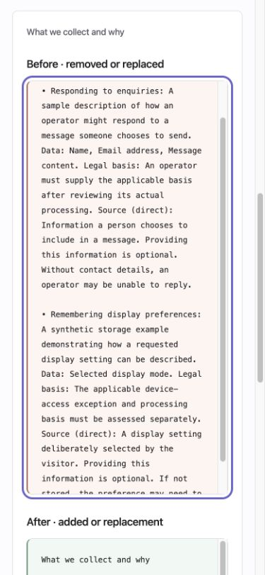

# Accessibility audit: current pages and components

Requirements: `REQ-PRODUCT-A11Y`, `REQ-PRODUCT-MOBILE`.

The October 2026 maintainer pass adds repeatable semantic checks and local browser fixtures. It found and corrected navigation, naming, contrast and keyboard defects. Accessibility support remains partial: this pass does not establish WCAG conformance, screen-reader support or coverage of every component state and platform.

## Run the checks

```sh
npm run site:build
node --test site/test/accessibility.test.mjs
npm run a11y:check
npm run a11y:fixture
npm run a11y:serve
```

`a11y:check` reads the current generated asset manifest and writes `.local/accessibility-static-report.json`. It checks current HTML pages, excluding retained files under `artifacts/`. It does not execute page scripts, load remote resources or inspect an operator database. Structural checks verify a main landmark, a page heading and a unique skip-link target in the main content. Findings and warnings fail the command; incomplete axe results remain in the report for review.

The tests also mount the real consent, terms-agreement, form-permission and setup components. Agreement and permission transport failures are intentional. Operator fixtures use the actual evidence/history/setup renderers with fresh in-memory stores, including a genuine compiled release comparison. They never select the website's operational workspace or use its credentials.

The local browser application is generated under `.local/accessibility-fixture/`. The read-only server binds to loopback at `http://127.0.0.1:4188/qa-a11y/`; use `npm run a11y:serve -- --port 4189` if that port is occupied. It never stops another server, accepts writes or serves symlinks outside its generated asset roots. Choose a scenario and select **Audit this scenario**. The raw report includes the engine version, browser, actual frame viewport, mounted state, violations and incomplete results. A fresh load ID, request ID and expected URL bind each response to its actual scenario; stale, mismatched and duplicate responses are rejected. A regression test reproduces late results across the iframe's surviving WindowProxy. The fixture's axe script retains its upstream license. These audit assets are absent from the production asset manifest and npm browser entry points. Maintainers choose when to run these tools; adopters decide their own CI workflow.

## Scope and observed results

The static pass checks every current HTML page. At this milestone it covers 303 pages with no detected semantic or structural failures. All pages retain incomplete results for rules that need layout APIs unavailable in JSDOM. Contrast is explicitly excluded from this environment, as documented in [axe-core's supported environments](https://github.com/dequelabs/axe-core/blob/develop/README.md#supported-browsers). The label-content/name rule is also excluded because the pinned implementation needs canvas/layout support absent from this JSDOM environment. Both rules run in the browser fixtures. Separate DOM regressions check the changed link/button labels against their visible text. These exclusions and incompletes are not counted as passes.

The browser pass uses pinned axe-core 4.14.0 with WCAG 2.0/2.1/2.2 A/AA and best-practice rule tags. Chromium 154 ran the following 32 scenarios at both desktop and mobile sizes:

- Homepage, agent guide and examples overview/topic pages.
- Light/dark cookie-choice, agreement and Google Basic pages; technology notice and privacy document.
- Operator evidence list/detail, release history/detail and document diff, plus three expanded record/diff views.
- Actual consent notice and native preferences dialog in light/dark themes.
- Actual agreement and form-permission fields, initially and after failed transport.
- Operator setup, and standalone setup at Start, Practices and prepared Review.

| Browser run | Outer viewport | Actual frame viewport | Scenarios | Detected violations | Fixture errors | Incomplete rule results |
| --- | --- | --- | --- | --- | --- | --- |
| Desktop Chromium | 1440 × 1000 | 1350 × 848 | 32 | 0 | 0 | 11 |
| Mobile-width Chromium | 390 × 844 | 375 × 848 | 32 | 0 | 0 | 14 |

The frame widths reflect the review application's padding and scrollbar. This is a desktop browser resized for mobile layout; it is not a physical phone or mobile-browser acceptance test. Static scenarios disable app scripts; separately named mounted scenarios exercise the actual library APIs. Assertions verify that requested dialogs, errors, setup steps and prepared recommendations were reached before scanning.

## Defects corrected

| Area | Correction |
| --- | --- |
| Google Basic themes | The shared skip link now reaches the main content in both themes. |
| Code examples | Highlighted blocks and setup's discovery command use a named group around their code. A plain `pre` cannot take an author-supplied accessible name with its default role; see [ARIA in HTML](https://www.w3.org/TR/html-aria/#el-pre). |
| Labels for speech input | Example links, setup steps, private-note summaries and Previous buttons retain their visible wording in the accessible name, following [Label in Name](https://www.w3.org/WAI/WCAG22/Understanding/label-in-name.html). |
| Headings | The logo-led project overview receives a page heading and useful title. Setup's discovery guide starts at the appropriate heading level. |
| Operator landmarks | The workspace rail is named; the short setup export note is an ordinary content container. It no longer creates a duplicate unnamed landmark beside the discovery guide. |
| Website contrast | The homepage code-panel caption no longer inherits light-surface text color. Examples card captions, document-preview labels, topic counts and step numbers use a darker secondary text color. |
| Operator contrast | Workspace labels and record footnotes use the shared secondary text color. The original browser findings included ratios of 4.10 and 3.97 against their actual surfaces. |
| Document comparison | Before/after text and raw-record blocks accept keyboard focus. Comparison groups have distinct names and a visible focus outline. |

The [WCAG contrast guidance](https://www.w3.org/WAI/WCAG22/Understanding/contrast-minimum.html) explains the minimum text ratios and exceptions. The browser checks use actual computed styles; JSDOM does not substitute for that measurement.

## Direct keyboard and incomplete-result review

A mobile-width native dialog exposed Close, both checkboxes, both legal links, Reject optional and Save choices in keyboard order. Opening it from **Privacy choices**, then pressing Escape, closed it and restored focus to that same trigger. The native browser handles the modal; this observation does not establish every browser's focus behavior.

In the mobile document comparison, PageDown focused and scrolled **Before text** from 0 to 112.5 CSS pixels. The block had 719 pixels of content in a 606-pixel viewport. Its focus outline and retained text remained visible.



The browser's incomplete results remain visible rather than being suppressed:

- Decorative arrow glyphs were not classified as ordinary text by the contrast rule.
- The homepage caption has a gradient background. Its secondary text color has a calculated ratio of at least 4.82 against the declared gradient endpoints; that check is separate from axe's unresolved gradient result.
- Theme-selector labels and some scrollable dialog text were reported as overlapping. The native mobile dialog was inspected directly: purpose descriptions were readable on the white surface, with secondary text `#65676f`. Offscreen or temporarily covered content still needs review across other viewport and text-size combinations.
- Closed-dialog triggers produced an unresolved reference check. The semantic regression test separately confirms each `aria-controls` reference resolves to exactly one real element; opening the actual dialog was also exercised in the browser.

The full reports stay in ignored local output. No incomplete result is evidence of conformance. WebKit, Firefox, physical devices, assistive technologies, forced colors, broader zoom/text-size combinations and the rest of the component/state matrix still need review. Existing focused layout and keyboard reports cover their own narrower scenarios.
