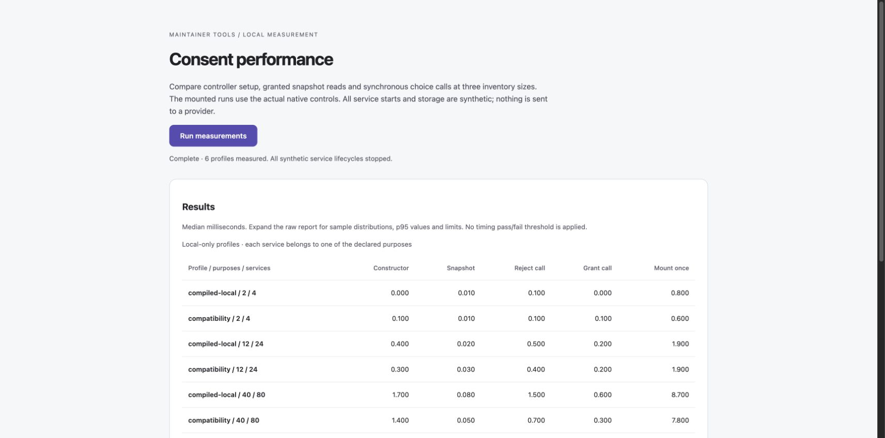

# Consent controller performance

Requirements: `REQ-PRODUCT-BUNDLE-BUDGET`, `REQ-PRODUCT-CONSENT-RUNTIME`, `REQ-PRODUCT-PRIVACY-SIGNALS`, `REQ-PRODUCT-PROCESSING-CHOICES`.

## Run the measurements

```sh
npm run perf -- --json
npm run perf:fixture
npm run perf:serve
```

The first command builds the workspace and reports Node CPU measurements. For JSON-only stdout after a build, use `node scripts/measure-consent-performance.mjs --json`; npm may print its own command/build messages. The other commands build a local browser fixture and serve it at `http://127.0.0.1:4188/`; select **Run measurements**. Use `npm run perf:serve -- --port 4189` if the port is occupied. The server never stops another process. It reuses the read-only QA asset handler, including its realpath boundary and GET/HEAD restriction, with both roots limited to the generated performance fixture.

These are optional maintainer tools. They do not set an adopter's CI policy or apply a timing pass/fail threshold. The fixture, raw reports and bundled test modules stay under ignored `.local/` output; the production asset manifest and npm runtime entries do not include them.

The same measurement loop runs through the actual public compatibility and compiled-local factories. Inputs contain 2/12/40 purposes and 4/24/80 services, with two services per purpose. Every service has an explicit processing classification. A configured GPC policy remains not observed during timing. Scope assessments are synthetic absent declarations; they establish nothing about a real site.

Each profile uses eight warmups and thirty samples. Snapshot samples average ten reads. Constructor timing includes normalization and initial synchronous state with fresh in-memory storage. Choice calls use registered synthetic lifecycles; the browser run additionally mounts the actual native controls and measures their synchronous updates. Each grant/rejection is checked, and every started lifecycle must stop. No external provider, recording endpoint, real visitor state or operator database is involved.

## Runtime change and regression coverage

The engine indexes its detached service inventory once. Service checks evaluate the selected service's declared activities directly instead of rebuilding the full privacy-signal map for every service. A public snapshot reads the processing-choice snapshot once and shares it only while deriving that result. Its public signal map remains independently constructed.

Permission decisions are not cached across queries or lifecycle checks. Both entry points have regressions for 40 purposes/80 services, changed processing restrictions, a restriction arriving before a queued loader starts, resumed eligibility and withdrawal, observed GPC, expiry, rejection and attempted mutation through returned config/snapshots. Existing required-receipt, cross-tab, scope and cleanup suites cover their own gates and races. A focused assertion detects repeated processing-snapshot reads; timing values themselves do not decide test success.

A Node run before the change measured the large granted snapshot at 0.089 ms median for compiled local and 0.086 ms for compatibility. After the change the same harness measured approximately 0.018 ms for both. This is an observed microbenchmark comparison on Node 26.10.0, Darwin arm64, Apple M5 Pro; it does not mean an entire site becomes five times faster. Raw distributions remain in ignored local reports.

## What these measurements exclude

Module download, parsing/evaluation, build-time compilation, returning-choice parsing, required receipts, an attached processing-choice controller, provider work, asynchronous lifecycle completion, browser paint, input delay and INP are outside the timed phases. Mounting is measured once per profile, rather than as a distribution. The browser surface is contained inside the fixture and is not a complete host page.

Snapshot p95 values describe ten-call averages, not individual-call tail latency. Browser clocks may be coarsened, so zero or rounded values do not mean no work occurred. The [High Resolution Time specification](https://www.w3.org/TR/hr-time-3/#sec-domhighrestimestamp) describes the clock and resolution limits. CPU load, JIT, garbage collection, browser scheduling and run order can affect results. A resized desktop browser does not measure a physical phone, and no CPU throttling is applied.

Broader page startup, real interaction/paint, independent processing and receipt configurations, Firefox/WebKit, mobile hardware and varied host inventories remain to be measured. The compatibility transfer target remains open; see [browser delivery](browser-delivery.md). Performance support remains partial.

## Observed Chromium run

On 19 October 2026, Chromium 154 completed all six profiles at desktop and mobile widths. The desktop viewport was 1728 × 856 CSS pixels with a 1000px measurement surface; the resized viewport was 390 × 844 with a 307px surface. The table shows the 40-purpose/80-service profiles. Values are milliseconds; each distributed phase is median / p95.

| Browser width / entry | Fresh constructor | Granted snapshot batch average | Reject call | Grant call | Mount once |
| --- | ---: | ---: | ---: | ---: | ---: |
| Desktop / compiled-local | 1.70 / 2.00 | 0.08 / 0.10 | 1.50 / 1.90 | 0.60 / 0.70 | 8.70 |
| Desktop / compatibility | 1.40 / 1.80 | 0.05 / 0.11 | 0.70 / 2.00 | 0.30 / 1.70 | 7.80 |
| 390px / compiled-local | 1.70 / 2.40 | 0.07 / 0.10 | 1.30 / 1.60 | 0.40 / 0.60 | 9.70 |
| 390px / compatibility | 0.90 / 1.50 | 0.07 / 0.11 | 1.30 / 2.60 | 0.40 / 0.70 | 9.00 |

These are measurements from one machine and run order, with no cross-platform speed claim. The small profiles include zero-duration samples at the browser clock's exposed resolution. The raw reports remain in `.local/consent-perf-browser-desktop.json` and `.local/consent-perf-browser-mobile.json`; Node runs use the same harness without mounting controls.


